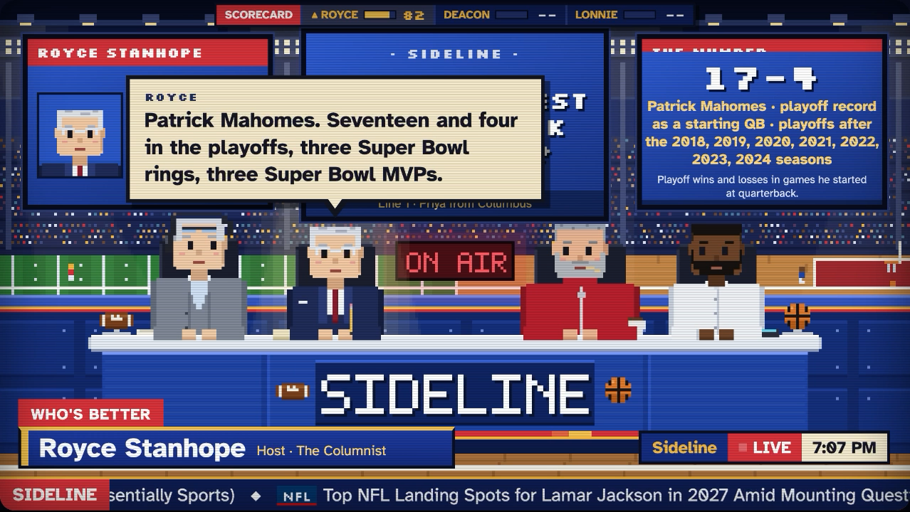
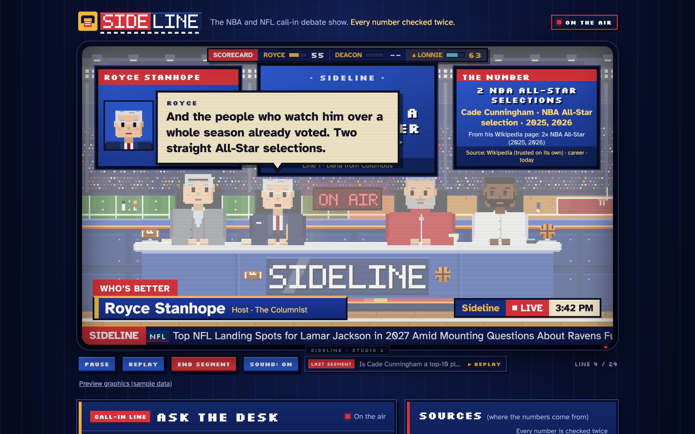
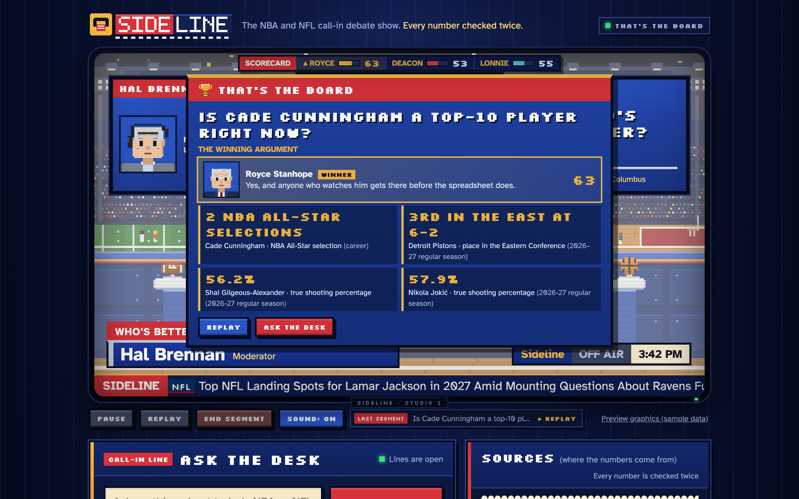
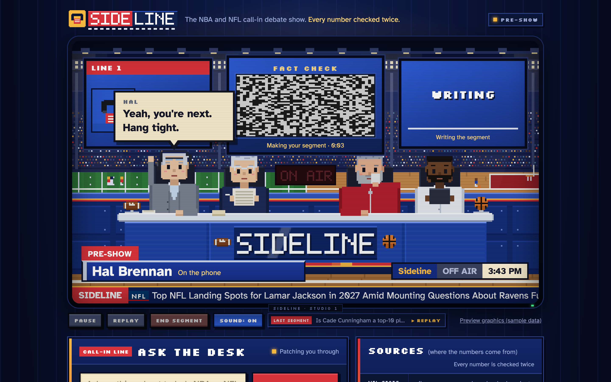
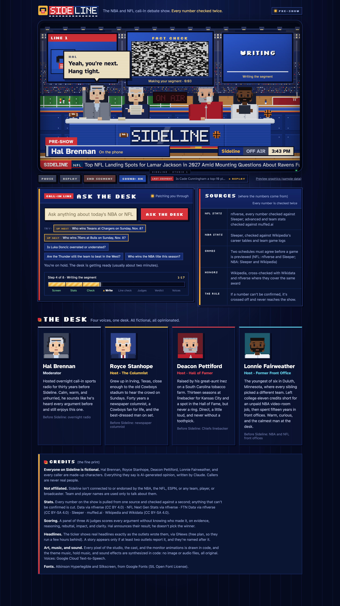

# Sideline

An AI sports debate show. You type in a question about the NBA or NFL, and about two minutes later a call-in show airs it. A caller asks your question, three AI hosts argue about it using real stats, and AI judges pick a winner. It all plays in a pixel-art TV studio with voices, subtitles, and music.

Ian Pierce · Final project · November 2026

## Try it

**Live version:** the link will be added here once it's online.

- To make a new segment, type the **access code** (it's in my submission) in the box next to the question, then type a question and click **Ask the desk**. It takes about 2 minutes, and you're "on hold" with the hosts getting ready while it's made.
- Without the code you can still watch saved segments: click **Last segment** under the TV.
- Click anywhere on the page once so your browser allows sound.
- If you see a "starting up" page, wait a minute or two. The free hosting goes to sleep when nobody has used it for a while.

## Watch it

[](docs/video/sideline-best-qb.mp4)

A 53-second clip of "Who is the best quarterback in the NFL?", starting with the hosts getting ready. Click the picture to open the video.

## What's in this repo

| What | Where |
| --- | --- |
| Slides | [docs/slides/Sideline-slides.pdf](docs/slides/Sideline-slides.pdf) |
| Video clip | [docs/video/sideline-best-qb.mp4](docs/video/sideline-best-qb.mp4) |
| Screenshots | [docs/screenshots/](docs/screenshots/) |
| Saved segments as readable transcripts (the script, the judges' scores, every stat used and how it was checked) | [outputs/](outputs/) |
| Saved segments as raw files, with the voice clips | [runs/](runs/) |
| The plan for the whole project | [BRIEF.md](BRIEF.md) |
| The characters | [characters/](characters/) |
| Every data source and whether I was allowed to use it | [SOURCES.md](SOURCES.md) |
| How the live version is hosted | [hosting/](hosting/) |
| The code | `server.py`, `generate.py`, `pipeline/`, `static/` (see [Files](#files)) |

## Screenshots

| On the air | The verdict |
| --- | --- |
|  |  |
| **While it's made:** the pre-show and the progress bar | **The whole page** |
|  |  |

## How it works

| Step | What happens | Done by |
| --- | --- | --- |
| 1. Check the question | Makes sure it's about the NBA or NFL and current players, and matches each name to a real player. If two players share a name, it asks which one. | Claude Haiku |
| 2. Find stats | An AI agent asks for the stats it wants, like a quarterback's playoff record, and the code pulls the real numbers from the data sources. | Claude Sonnet |
| 3. Double-check | Each stat is pulled again from a second source and compared. If they don't match, it's thrown out and the agent looks for a replacement. | Code |
| 4. Write and check | The script can only use stats that passed. Code checks every number in every line, and another AI reads every claim. Bad lines get rewritten or cut. | Claude Sonnet and code |
| 5. Judge and voice | Three AI judges score each argument without seeing names, and code adds up the scores. Then every line gets a voice and it plays in the studio. | Claude Sonnet and Google voices |

Each saved segment in `runs/` has `script.json` (the show), `fact_pack.json` (every checked stat), `rejection_log.json` (every stat and line that was thrown out, fixed, or cut, and why), `judge.json` (the scores), and the voice clips. Only the 10 newest are kept.

## What I had to make sure of

**Accuracy.** I didn't want the hosts using made-up stats. Every stat gets double-checked, and if it can't be confirmed, it doesn't get used. Every line is checked again after it's written. To test it, I had a stronger AI (Claude Opus) check every claim in finished scripts. At first 95% of claims were backed up by the stats; by the end it was about 99%.

**Realistic opinions.** I wanted the hosts to use the eye test, but their opinions still had to make sense. They shouldn't call a bad 3-point shooter a sharpshooter, or a slow quarterback a dual threat. So for each player in a segment, it ranks how he plays against others at his position (how much he runs, how far he throws, how many threes he makes, and so on). The writer sees that in words, and if a line uses a label that doesn't fit the player, it gets flagged and rewritten.

## The hardest part: finding data

I wanted to do college football and basketball too, but besides basic stats, almost all of that data is behind a paywall, so I stuck with the NBA and NFL. A lot of sites were also off-limits because their terms don't allow bots or AI, including ESPN, Pro Football Reference, Basketball-Reference, and NBA.com. I ended up ruling out 14 sites. The show uses free sources that allow this kind of use: [Sleeper](https://docs.sleeper.com/), [nflverse](https://github.com/nflverse), [muffed.ai](https://muffed.ai), and Wikipedia. The full list, with the reason for each one, is in [SOURCES.md](SOURCES.md).

## Run it on your own computer

You need Python 3 and a Claude API key from [console.anthropic.com](https://console.anthropic.com). The scripts below are for a Mac.

```bash
git clone https://github.com/IanPierce57/sideline.git
cd sideline
./set_key.sh
./start.sh
```

`set_key.sh` asks for your Claude key in a pop-up and saves it in a file called `.env`, which never gets uploaded. `start.sh` installs what it needs the first time (about a minute), starts the server, and opens http://localhost:8000. Leave its Terminal window open while you use the page; press **Control-C** there to stop it.

Two more keys are optional: a Google Cloud Text-to-Speech key for the voices (`./set_key.sh google`) and a free [gnews.io](https://gnews.io) key for the news ticker (`./set_key.sh gnews`). Without them, segments play with subtitles only and the ticker shows a placeholder.

On a computer that isn't a Mac: copy `.env.example` to `.env`, put your key after `ANTHROPIC_API_KEY=`, then run:

```bash
python3 -m venv .venv
.venv/bin/pip install -r requirements.txt
.venv/bin/python server.py
```

To make a script without the page: `.venv/bin/python generate.py "Who wins the Super Bowl this season?"`

**Using the page:** **Pause** (Space), **Replay**, **End segment** (Esc, jumps to the verdict), **Sound**, and **Last segment** (replays a saved segment for free). **Preview graphics (sample data)** shows every on-screen graphic with numbers marked SAMPLE.

## Cost

A new segment costs about 60 cents in Claude API credits (the QB segment cost $0.63). The voices are free within Google's monthly allowance. Replaying a saved segment costs nothing.

## Tests

Free (no AI calls): `tests/accuracy.py` (do the data sources still agree?), `tests/linecheck_test.py`, `tests/style_test.py`, `tests/positions_test.py`, `tests/news_test.py`, and `tests/voices_test.py`. A few cents each: `tests/pipeline_test.py` (research and checking on six topics) and `tests/audit.py --latest 4` (a stronger model checks every claim in recent scripts). Run them with `.venv/bin/python tests/<name>.py`.

## Files

| File | What it is |
| --- | --- |
| `generate.py` | Runs the whole process for one question and saves the segment. |
| `pipeline/` | Each step: the question check and research, the stat list and checker, injuries, player styles, the line checker, the judges, the voices, and the data sources. |
| `server.py` | The small web server the page talks to. |
| `static/index.html`, `style.css` | The page and its TV look. |
| `static/studio.js` | Draws and animates the pixel studio and cast. |
| `static/monitor.js` | The loading animations on the center monitor. |
| `static/sound.js` | The theme music and sound effects, made in code (no audio files). |
| `static/app.js` | Runs the show: pre-show, countdown, voices and subtitles, graphics, the end card. |
| `start.sh`, `set_key.sh` | Start everything, and save a key without showing it. |
| `export.py` | Writes the transcripts in `outputs/` and builds a zip of the project. |
| `hosting/` | The setup for the live version. |
| `originals/` | The original planning documents (the brief and the character bibles). |
| `CLAUDE.md` | Project notes for Claude Code (the AI coding tool). |
